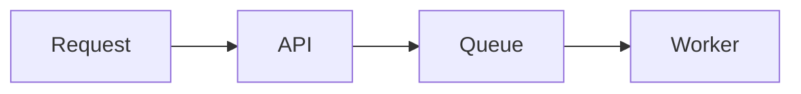

# Authoring presentations and documents

Silmaril turns ordinary headings into presentations or single-page scrolling documents.

````markdown
# Architecture review

How requests move from the gateway to storage

## Request path

1. The gateway authenticates the caller.
2. The API validates the request.
3. The worker persists the result.

## Failure handling


````

## Structure

- Use one optional `#` heading for the presentation title.
- Put an optional subtitle paragraph directly below that title, before the first slide.
- Use a `##` heading for every slide.
- Put the slide body below its heading.
- Repeated slide titles receive stable numbered identifiers in source order.
- Headings inside fenced code blocks remain code.

When the `#` heading is omitted, the Markdown filename becomes the title.

The subtitle is the first paragraph after the title, with blank lines allowed between them. Physical line breaks inside that paragraph become line breaks in the overview. It is plain text, like the title: Markdown formatting and HTML are displayed literally. Lists, quotes, code blocks, and headings do not become subtitles. Later preamble paragraphs are not included.

The board overview shows the subtitle below the title in smaller, muted text. Long text wraps, and the overview fits the heading and slide cards without overlap. Subtitles do not change the browser title, slide count, or focused-slide view.

### Choose the output type

The output type is explicit Markdown metadata. It defaults to presentation when the directive is absent:

```markdown
# Architecture review

:::silmaril document
:::

## Context

Natural-height document content.
```

Use `:::silmaril presentation` to select the presentation explicitly. `:::silmaril document` selects a continuous, natural-height page. No directive remains the presentation default.

Place the directive in the title preamble before the first `##` heading. The block must contain exactly no body text, may appear only once, and must close with `:::`. Missing or unknown types are rejected.

In document mode, `##` headings create ordered natural-height sections, not fixed 1000 × 700 presentation cards. The title, subtitle, presentation color/typography tokens, footer content, local and remote images, Markdown formatting, tables, code, and Mermaid diagrams remain presentation-styled. The page scrolls normally and does not initialize impress.js or slide fitting. Footers appear once at the end of the document.

### Section slides

Use `:::section` below a `##` heading to center the heading in the middle of the slide:

```markdown
## Architecture
:::section
Paths, storage, and recovery
:::
```

The block body is an optional plain-text subtitle. Leave the block empty for a title-only section slide:

```markdown
## Architecture
:::section
:::
```

The `:::section` block must be the entire body of the slide. An empty block creates a title-only section slide. An unterminated block or text after the closing `:::` is rejected.

### Footers

Deck-wide footer blocks can add an image-plus-text line to the left or right side:

```markdown
# Architecture review

Engineering design review

:::footer left
 Acme Engineering
:::

:::footer right
Internal · 2026
:::

## Request path
```

Place `:::footer left` or `:::footer right` blocks in the title preamble, before the first slide. Each block is optional and accepts exactly one non-empty line. The line can use inline Markdown, including a local or embedded image. Duplicate sides, unknown sides, unterminated blocks, and multiline text are rejected.

In presentation output, the left and right footers remain fixed in the bottom-left and bottom-right corners of the whole-board overview and focused slides. They do not consume slide-card layout space.

In document output, the left and right footers appear together once at the end of the document in normal flow. They do not remain visible while scrolling and do not repeat between sections.

## Slide content

Slide bodies support paragraphs, lists, tables, emphasis, highlight, strikethrough, images, syntax-highlighted code, and Mermaid diagrams. Use `==text==` for highlight and `~~text~~` for strikethrough. Raw HTML is escaped. Local images are embedded in the HTML output. HTTP and HTTPS image URLs are downloaded and embedded during publish or preview, so the presentation remains self-contained. Links to websites open in a new tab.

```markdown

```

Inline images and reference-style images are supported, including inside columns. Image syntax inside code remains code. Supported image types are PNG, JPEG, GIF, SVG, WebP, and AVIF. Remote servers must return a supported image `Content-Type`; a page URL that returns HTML is not an image URL. URL query strings are preserved, and redirects are followed.

Each render loads a remote URL once and reuses its bytes across slides. Later renders fetch it again, so a changed remote image can change the output. A failed download, unsupported media type, or empty response stops rendering with an error. Publish leaves an existing output file unchanged if image loading fails.

You can also author two equal-width columns with a copy-paste block:

```markdown
:::columns
Left column body with paragraphs, lists, and emphasis.

---

Right column body with its own Markdown, including nested lists and code blocks.
:::
```

Inside a `:::columns` block, a top-level `---` is a column divider rather than a thematic break or horizontal rule. Each column can contain recursive Markdown bodies, and the layout stacks on narrow screens and print output.

### Content fitting

Content fitting applies only to presentation output. When a slide overflows, Silmaril reduces its heading, body fonts, and text spacing by one shared factor. It measures the result after text wraps and keeps the largest factor that fits the existing card. Slides that already fit keep their normal sizes. Images and diagrams shrink within the available space.

Fitting runs again after content edits, image and font loads, and window size changes. Removing excess content restores normal sizes. There is no minimum font size, so very dense slides can become difficult to read. Split them into more slides for a larger font. If fixed content, such as a table's borders, cannot fit at any font size, the card scrolls instead of cropping it.

Document output does not fit or shrink fixed cards. It uses natural section height and normal browser scrolling.

## Publish

```sh
node dist/cli.js publish talk.md
node dist/cli.js publish talk.md --out talk.html
node dist/cli.js publish talk.md --open
```

Without `--out`, Silmaril writes `<source-name>.html` to the system temp directory.

## Present

The presentation starts on the whole-board overview. Arrow keys move through slides. Focused-slide mode isolates the active slide and shows quiet edge cues when another slide exists in that direction. The board signature is `silmaril · <version>`.

Document output starts at the document header and scrolls naturally. Its `##` sections are stable source anchors, and the board signature is omitted from document content.

## Edit with live reload

```sh
node dist/cli.js serve talk.md
node dist/cli.js serve talk.md --port 4000
node dist/cli.js serve talk.md --open
```

`serve` (`silmaril serve`) starts a local server with live reload on port 5173 by default. Edit the Markdown in your own editor and the browser reloads on save, so the file stays the source of truth. Rendering is full fidelity, including Mermaid. Strong emphasis uses an amber color with WCAG AA contrast in both display modes.

## Library API

If you want to render a Markdown string from another program, import `render` from `silmaril` and pass the content in memory:

```js
import { render } from "silmaril";

const markdown = "# Review\n\n## Context\n\nRender this from memory.";
const { html, slideCount, type } = render(markdown, {
  title: "Review deck",
  assetBaseDir: "/assets",
});
```

`render(markdown, options)` synchronously returns `{ html, slideCount, type }` and supports local and embedded images. `type` is `"presentation"` or `"document"`. The options object can include `title`, `assetBaseDir`, `version`, `repositoryUrl`, and `liveReload`. Local image paths are resolved relative to `assetBaseDir`.

For remote images, use the additive async API:

```js
import { renderAsync } from "silmaril";

const { html, slideCount, type } = await renderAsync(
  "## Diagram\n\n",
);
```

`renderAsync(markdown, options)` accepts the same options and returns a Promise of `{ html, slideCount, type }`. CLI publish, live serve, and the Obsidian plugin await this shared path internally. Existing synchronous `render()` callers do not need to change.
