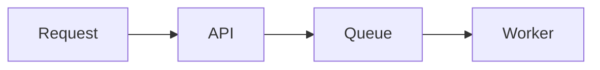

# Authoring presentations

Silmaril turns ordinary headings into slides.

````markdown
# Architecture review

## Request path

1. The gateway authenticates the caller.
2. The API validates the request.
3. The worker persists the result.

## Failure handling


````

## Structure

- Use one optional `#` heading for the presentation title.
- Use a `##` heading for every slide.
- Put the slide body below its heading.
- Repeated slide titles receive stable numbered identifiers in source order.
- Headings inside fenced code blocks remain code.

When the `#` heading is omitted, the Markdown filename becomes the title.

## Slide content

Slide bodies support paragraphs, lists, tables, emphasis, local images, syntax-highlighted code, and Mermaid diagrams. Raw HTML is escaped. Local images are embedded in the HTML output. Remote links and remote images are rejected so the presentation remains self-contained.

## Build

```sh
node dist/cli.js build talk.md
node dist/cli.js build talk.md --out talk.html
node dist/cli.js build talk.md --open
```

Without `--out`, Silmaril writes `<source-name>.html` to the system temp directory.

## Present

The presentation starts on the whole-board overview. Arrow keys move through slides. Focused-slide mode isolates the active slide and shows quiet edge cues when another slide exists in that direction. The board signature is `silmaril · <version>`.

## Edit with live reload

```sh
node dist/cli.js serve talk.md
node dist/cli.js serve talk.md --port 4000
node dist/cli.js serve talk.md --open
```

`serve` (`silmaril serve`) starts a local server with live reload on port 5173 by default. Edit the Markdown in your own editor and the browser reloads on save, so the file stays the source of truth. Rendering is full fidelity, including Mermaid. Strong emphasis uses an amber color with WCAG AA contrast in both display modes.
