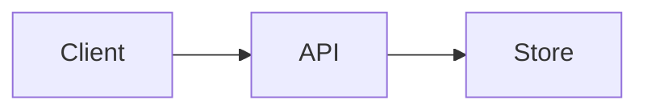

# Silmaril authoring guide

Silmaril accepts a single markdown scene file and turns it into a deterministic single-file HTML canvas. The public entry point is `build`. The engineering theme uses heading-defined slides, while the legacy themes use the bullet-based region grammar.

## 1. Frontmatter

Start the file with a YAML-like frontmatter block delimited by `---` on the first and last lines:

```md
---
title: Quick sketch
theme: sketch
canvas:
  width: 1600
  height: 900
---
```

Supported frontmatter keys:

- `title`: string, used as the generated HTML document title.
- `theme`: `engineering`, `cards`, `atlas`, or `sketch`. The CLI uses this value unless `--theme` overrides it.
- `canvas.width` and `canvas.height`: positive numbers for the scene canvas dimensions.

The parser accepts simple scalars (`true`, `false`, `null`, strings, numbers) and nested objects. Arrays are not part of the current grammar.

## 2. Region grammar

For the `engineering` theme, use one `#` heading for the board title and one `##` heading for each ordered slide:

````md
# Service readiness

## Request path



## Rollout

Ship behind a feature flag, then expand by measured stages.
````

Mermaid flowchart fences are compiled at build time into deterministic inline SVG. Diagram colors use the engineering theme tokens, so dark and light mode switch together. The generated HTML contains no Mermaid runtime library and no remote or CDN diagram reference.

For `cards`, `atlas`, and `sketch`, write one region per top-level bullet list item. The region title is the text of the bullet. Indented lines that follow belong to the region body.

```md
- Overview
  Start with the whole story in one glance.

- Detail
  Zoom in for supporting evidence.
```

The parser treats the body as markdown content and preserves region order. Use an explicit `@silmaril` block for placement metadata:

```md
- Detail
  - @silmaril:
    - x: 1700
    - y: -150
    - scale: 1
    - rotate: 6
  ## Slides are a line. Ideas are a place.

  Keep **spatial context** while you present.
```

Ordinary bullets containing colons remain presentation content. Legacy `x`, `y`, `scale`, `rotate`, and `group` bullets are still accepted for compatibility.

## 3. Grouping and layout

Use a nested group inside `@silmaril` to keep regions together:

```md
- Overview
  Open the scene with a map-like overview.

- Detail
  - @silmaril:
    - group:
      - id: evidence
  Add a focused detail card.
```

The current public build path uses deterministic auto-layout:

- an empty whole-board overview is the first camera target;
- the overview center is derived from the minimum and maximum region coordinates;
- every unpositioned region receives a distinct deterministic placement;
- grouped regions retain their authored order.

Manual `x`, `y`, `scale`, and `rotate` values flow through the public `build` command. Sparse placement is supported: author only the fields you want to override and the theme keeps its values for the rest.

## 4. Markdown body rules

Region bodies are rendered as markdown. Silmaril sanitizes HTML and disables remote links and images. Local images are inlined into the final file, so the single HTML output stays self-hosted.

This means:

- raw HTML is escaped rather than emitted;
- remote image and link references are rejected;
- local assets are embedded as data URIs.

## 5. Themes

The `build` command accepts four themes through frontmatter or `--theme`:

- `engineering`: minimalist dark-first slides with a persistent light-mode toggle and build-time inline Mermaid flowcharts.
- `cards`: dark presentation cards with authored semantic emphasis.
- `atlas`: parchment location cards on a neutral canvas.
- `sketch`: hand-drawn cards on a neutral canvas.

All four themes open on the content-free whole-board overview, keep every region at a distinct location, and use the authored title for the browser tab. The repository showcase sources are exact accepted prototypes and retain their richer fixed scenery and routes.

The repository showcase sources demonstrate the richer conventions for each accepted presentation:

- [cards-tour.md](../examples/cards-tour.md)
- [atlas-tour.md](../examples/atlas-tour.md)
- [sketch-tour.md](../examples/sketch-tour.md)

If neither frontmatter nor `--theme` selects a theme, Silmaril uses `cards`. An explicit `--theme` always wins over frontmatter.

## 6. Determinism and self-hosting

Silmaril aims for deterministic output. The parser preserves region order, the layout engine uses stable placement rules, and the themes render from fixed assets. That makes it practical to compare two builds of the same markdown and expect the same HTML structure.

Self-hosting is part of the authoring contract: the build output is a single HTML file, local assets are inlined, and remote asset references are rejected. There is no separate ownership-validation command in the current public CLI; the authoring contract is enforced by the parser and renderer instead.

## 7. CLI entry points

Use the CLI to validate and build your scene:

- `doctor` checks the local environment.
- `schema` prints the public command catalog.
- `build` writes the HTML presentation. Without `--out`, the file is named after the markdown source and written to the operating system temp directory.
- `update` self-updates the checkout.

The CLI supports global `--help` and `--version` flags. The `build` command adds `--emit-scene` for inspecting the parsed scene IR.
