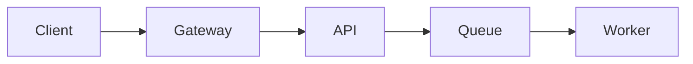

# Engineering review performance fixture

## Executive summary

The system is ready for the next rollout stage.

## User impact

The current cohort sees lower latency and fewer retries.

## Request path

Traffic moves through the gateway, API, queue, and worker.

## Capacity

Peak load remains below the tested service envelope.

## Reliability

The error budget remains healthy across all production regions.

## Deployment

The deployment uses staged cohorts with automated health checks.

## Observability

Dashboards cover latency, throughput, failures, and saturation.

## Security

Authentication and authorization run before request processing.

## Data flow



## API contract

```ts
type Result = {
  id: string;
  status: "ready" | "pending";
};
```

## Dependencies

All production dependencies have explicit owners and health signals.

## Failure handling

Retries are bounded and dead-lettered work remains inspectable.

## Rollback

The previous build remains available throughout the rollout.

## Testing

Unit, integration, and browser coverage exercise the release path.

## Performance

Build output remains deterministic across repeated runs.

## Accessibility

Text and emphasis maintain readable contrast in both display modes.

## Operations

Runbooks cover deployment, rollback, and incident diagnosis.

## Ownership

Each service and alert has a named engineering owner.

## Decision

Proceed with the next cohort after the final health review.

## Next step

Record the rollout result and update the service baseline.
